# Autonomous AI Data Scientist (AADS)
## Utkrishta 2026 AI/ML Hackathon — Challenge 1: Budget-Constrained Churn Prediction

[](https://colab.research.google.com/github/udayl/IOTAxEnigmaHackathon/blob/uday/notebooks/colab_training.ipynb)


An autonomous, self-directed machine learning system designed to solve tabular customer churn prediction under a strict **15-experiment computational budget invariant**. Combining the cognitive hypothesis generation of **Google Gemini 2.5 Flash** with a deterministic **Mathematical Inference Engine**, the system methodically explores the hyperparameter and feature-engineering landscape while cryptographically guaranteeing data integrity and zero test-set leakage.

---

## ⚡ Google Colab Training Quickstart

You can train and reproduce the entire 15-experiment autonomous loop directly in Google Colab with GPU acceleration and zero local setup.

### 1. Launch in Google Colab
Click the badge above or open [`notebooks/colab_training.ipynb`](notebooks/colab_training.ipynb) in Colab.

### 2. Runtime Selection
- In Colab, select **Runtime** $\rightarrow$ **Change runtime type** $\rightarrow$ **T4 GPU** (Hardware Accelerator).
- The framework automatically detects the CUDA device and enables GPU training (`task_type="GPU"`) in CatBoost.

### 3. Setup Gemini API Key
- Add your API key to Colab Secrets (**Key icon** in the left sidebar) with name `GEMINI_API_KEY` and toggle **Notebook access** to ON.
- *Alternatively, leave blank to run in deterministic offline simulation mode (`MOCK_SUPERVISOR=true`).*

### 4. Execute the Training Pipeline
Run the notebook cells sequentially, or execute in a single cell:
```bash
!git clone https://github.com/udayl/IOTAxEnigmaHackathon.git
%cd IOTAxEnigmaHackathon
!pip install -q -r requirements.txt
!python scripts/prepare_data.py
!python scripts/run_autonomous_loop.py --live --device auto --clean-ledger
!python scripts/evaluate_holdout.py
!python scripts/export_submission.py
```

For the comprehensive cloud training guide, see [docs/GOOGLE_COLAB_TRAINING.md](docs/GOOGLE_COLAB_TRAINING.md).

---

## 💻 Local Quickstart

### 1. Installation
Clone the repository and set up a virtual environment:
```bash
git clone https://github.com/udayl/IOTAxEnigmaHackathon.git
cd IOTAxEnigmaHackathon

# Using uv (recommended) or standard venv
uv venv
source .venv/bin/activate
uv pip install -r requirements.txt
```

### 2. Environment Variables
Create a `.env` file based on `.env.example`:
```bash
cp .env.example .env
# Edit .env and supply GEMINI_API_KEY=...
```

### 3. Data Preparation
Ingest and clean the dataset, partition into 80% train-val and 20% sealed holdout, and compute the cryptographic manifest:
```bash
python scripts/prepare_data.py
```

### 4. Launch Autonomous Experiment Loop
```bash
# Rapid verification loop (simulated telemetry, no model fitting)
python scripts/run_autonomous_loop.py --clean-ledger

# Full live training with CatBoost 5-fold cross-validation and auto GPU/CPU detection
python scripts/run_autonomous_loop.py --live --device auto --clean-ledger
```

### 5. Final Holdout Evaluation & Submission Export
```bash
python scripts/evaluate_holdout.py
python scripts/export_submission.py
```

---

## 🏛️ System Architecture

```mermaid
flowchart LR
    A["Raw Dataset Ingestion"] --> S["Stratified 80/20 Partition"]
    S --> V["Data Provenance Guard (SHA-256 Manifest)"]
    V --> P["Pre-Flight Profiler (Zero-Cost Step 0)"]
    P --> L["Lock Best Classifier (CatBoost)"]
    L --> B["Supervisor: Gemini LLM + Math Engine"]
    B --> G["BudgetGuard (Strict <= 15 Fits)"]
    G --> M["Dynamic Feature Pipeline & CatBoost Fit (GPU/CPU)"]
    M --> CV["5-Fold Stratified Cross-Validation"]
    CV --> T["Telemetry: ROC-AUC, Loss, SHAP, DeLong"]
    T --> B
    T --> E["Post-Run 15: Champion Model & Submission CSV"]
```



### Key Pillars & Invariants
1. **Strict 15-Run Budget Invariant**: An atomic [`BudgetGuard`](src/budget/guard.py) intercepts and registers every model fit. Attempting a 16th experiment raises `BudgetExhaustedError` and halts execution.
2. **Pre-Flight Classifier Selection & Lock**: At Step 0 (zero budget cost), the system evaluates dataset meta-features (78.9% categorical, sample-to-dimension ratio) and locks `CatBoostClassifier` for all 15 iterations.
3. **Dual-Brain Supervisor**: Combines the semantic hypothesis generation of Google Gemini (`gemini-2.5-flash`) with a deterministic [`MathematicalInferenceEngine`](src/supervisor/math_engine.py) (Overfitting Index $\Omega$, DeLong test $p$-values, TreeSHAP importance, Expected Calibration Error).
4. **Data Provenance & Isolation Guard**: Intercepts every batch to verify cryptographic SHA-256 hashes and set-theoretic index containment.
5. **Hardware Device Abstraction Layer**: Automatically detects NVIDIA CUDA GPUs (e.g. in Google Colab) or falls back to multi-threaded CPU execution.
6. **Sealed 20% Holdout Split**: Strict air-gap isolation; the sealed holdout partition is unlocked only after Experiment 15 concludes.

---

## 📊 CLI Options

### `scripts/run_autonomous_loop.py`
| Argument | Type | Default | Description |
| :--- | :--- | :--- | :--- |
| `--live` | flag | `False` | Fits actual CatBoost models on 5-fold CV (loads weights) |
| `--device` | string | `auto` | Hardware acceleration target: `auto`, `gpu`, or `cpu` |
| `--max-runs` | int | `15` | Maximum experiment limit (enforced $\le 15$) |
| `--clean-ledger` | flag | `False` | Clears previous experiment ledger before run |
| `--colab` | flag | `False` | Auto-detects and integrates with Google Colab |

---

## 📁 Repository Structure

```
├── .env.example                   # Environment configuration template
├── pyproject.toml                 # Package configuration
├── requirements.txt               # Pinned dependencies
├── README.md                      # Project documentation & Colab quickstart
├── TECHNICAL.md                   # Exhaustive technical specification
├── docs/
│   ├── ARCHITECTURE.md            # System architecture details
│   └── GOOGLE_COLAB_TRAINING.md   # Comprehensive Google Colab guide
├── notebooks/
│   └── colab_training.ipynb       # Turnkey interactive Google Colab notebook
├── scripts/
│   ├── prepare_data.py            # Data sanitization, 80/20 split & manifest
│   ├── run_autonomous_loop.py     # Main 15-run orchestrator loop CLI
│   ├── evaluate_holdout.py        # Sealed holdout evaluation script
│   └── export_submission.py       # Organizer submission CSV generator
├── src/
│   ├── budget/guard.py            # Atomic 15-run BudgetGuard
│   ├── data/                      # Loader, cleaner, splitter, provenance guard
│   ├── features/                  # Dynamic feature engineering pipeline
│   ├── models/                    # CatBoost model wrapper & hardware abstraction
│   ├── optuna_tpe/                # Optuna TPE single-trial sampling bridge
│   ├── supervisor/                # Gemini client, math engine, schemas, prompt
│   ├── telemetry/                 # Append-only JSONL experiment ledger
│   └── utils/environment.py       # Colab & GPU hardware acceleration utilities
└── tests/                         # Full pytest test suite (12 tests)
```

---

## 🧪 Testing

Run all unit tests using pytest:
```bash
pytest
```
*Includes tests for budget guards, cryptographic data provenance, mathematical diagnosis, Colab environment resolution, and CatBoost GPU fallback.*

---

## 📖 Further Documentation
- [Google Colab Training Guide](docs/GOOGLE_COLAB_TRAINING.md)
- [System Architecture](docs/ARCHITECTURE.md)
- [Full Technical Specification](TECHNICAL.md)
