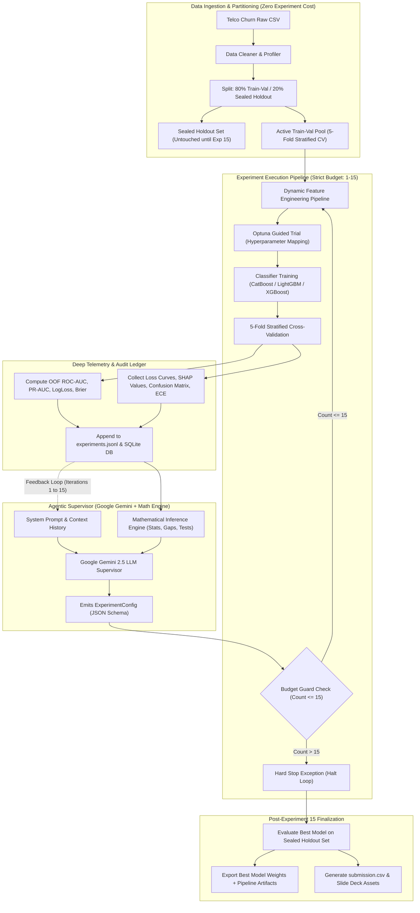
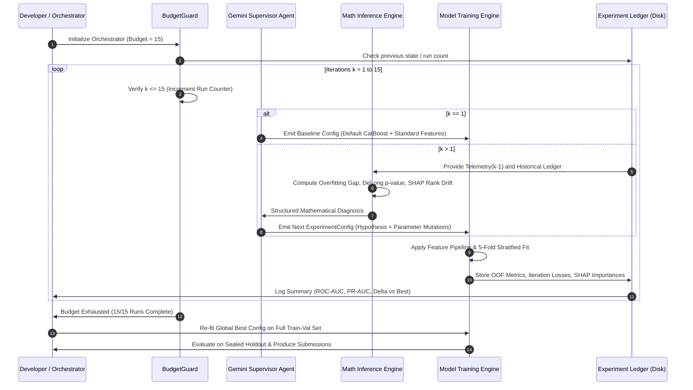

# TECHNICAL SPECIFICATION: AUTONOMOUS AI DATA SCIENTIST (AADS)
## Utkrishta 2026 AI/ML Hackathon — Challenge 1: Budget-Constrained Experiment Optimization for Churn Prediction

---

## 1. Executive Summary & Problem Formulation

### 1.1 Objective
The goal is to engineer an **Autonomous AI Data Scientist (AADS)** that iteratively designs, trains, evaluates, and refines predictive classification models for customer churn under a **strict hard limit of 15 model-training experiments**.

Rather than relying on brute-force grid searches or uncontrolled AutoML sweeps, the system implements an **end-to-end agentic feedback loop**. A centralized **Supervisor Agent** (powered by Google AI Studio Gemini LLMs coupled with a deterministic **Mathematical Inference Engine**) analyzes deep training telemetry, diagnostic curves, and statistical tests from prior runs to rationally navigate model families, feature sets, and hyperparameter spaces.

### 1.2 Official Hackathon Rules & Evaluation Guardrails
As specified in *Utkrishta 2026 Challenge 1*:
* **Dataset**: Telco Customer Churn tabular dataset (single-table customer demographics, subscribed services, account details, and churn target).
* **Strict Constraint**: **Maximum 15 Model-Training Experiments**.
  * **What counts as 1 experiment**: Exactly one complete `fit-and-validation` cycle (e.g., 5-Fold Stratified Cross-Validation on the training split).
  * **What does NOT count**: Data ingestion, exploratory data analysis (EDA), cleaning, statistical profiling, and feature engineering transformations that do not fit a supervised estimator.
* **Primary Metric**: **ROC-AUC Score** evaluated on the organizer-held hidden test set.
* **Secondary Metric**: **PR-AUC (Average Precision)** to evaluate ranking efficacy under customer churn class imbalance.
* **Leaderboard Formula**:
  $$\text{Final Score} = \text{ROC-AUC} \times \text{Efficiency Factor}$$
  Where $\text{Efficiency Factor} = 1.0$ if $\text{Experiments} \le 15$, and drops severely (or disqualifies) if $\text{Experiments} > 15$.
* **Final Deliverables**:
  1. Fully functional, reproducible source code repository.
  2. Complete `README.md` and `TECHNICAL.md` documentation.
  3. Formatted prediction results file matching organizer schema.
  4. 10-slide presentation deck (PPT) detailing chronological runs, architecture, and validation trajectories.
  5. Live / Video working demonstration.

---

## 2. System Architecture & Agentic Loop

### 2.1 High-Level Architecture Diagram



### 2.2 Sequence of Iterative Agentic Cycles



---

## 3. Strict Budget Guard & Experiment Invariants

### 3.1 The 15-Run Invariant
The most critical constraint of Challenge 1 is that **no more than 15 model-training cycles may occur**. Exceeding 15 runs compromises the Efficiency Factor and risks disqualification.

To ensure deterministic compliance across human developers and automated coding agents:
1. **Physical Lock (`BudgetGuard`)**: A singleton class wrapping model fitting methods. It reads an atomic persistent counter from `artifacts/experiment_ledger.json`. If `current_run_count >= 15`, any call to `fit()` raises a `BudgetExhaustedError` exception that cannot be caught internally.
2. **One Experiment Definition**:
   * An experiment is defined strictly as **one end-to-end fit-and-validation pipeline run**.
   * Performing 5-Fold Stratified Cross-Validation on a specific configuration counts as **1 experiment**.
   * Hyperparameter adjustments require a new experiment.
   * Data preparation, feature generation without model fitting, and post-fit inference do not consume the budget.

### 3.2 State Persistence & Crash Resilience
* Every experiment's full configuration, random seed, execution timestamp, commit hash, telemetry data, and validation metrics are written to disk **atomically before the next cycle starts**.
* If an experiment crashes or the API rate-limits, the system restarts from the last valid experiment index without losing previous runs or double-counting.

---

## 4. Mathematical Inference Engine (Supervisor Reasoning)

The LLM Supervisor does not guess hyperparameter mutations arbitrarily. Before each LLM prompt invocation, the deterministic **Mathematical Inference Engine** computes quantitative diagnostic metrics. These formulas provide an empirical basis for the LLM's next decision.

### 4.1 Generalization Gap & Overfitting Index
Let $\mathcal{L}_{\text{train}}^{(k)}(t)$ and $\mathcal{L}_{\text{val}}^{(k)}(t)$ be the loss (LogLoss) at training boosting iteration $t$ of experiment $k$:

$$\Delta_{\text{gen}}^{(k)} = \mathcal{L}_{\text{val}}^{(k)}(t^*) - \mathcal{L}_{\text{train}}^{(k)}(t^*)$$

Where $t^* = \arg\min_t \mathcal{L}_{\text{val}}^{(k)}(t)$ is the optimal early-stopping iteration.

The **Overfitting Index** $\Omega^{(k)}$ is defined as:
$$\Omega^{(k)} = \frac{\Delta_{\text{gen}}^{(k)}}{\mathcal{L}_{\text{val}}^{(k)}(t^*)} \times 100\%$$

* **Decision Rule**:
  * If $\Omega^{(k)} > 18\%$: Severe Overfitting $\rightarrow$ Supervisor must increase $L_2$ regularization (`l2_leaf_reg`), decrease tree depth (`depth` $\le 4$), decrease learning rate, or increase feature/subsample bagging (`subsample` $\in [0.6, 0.8]$).
  * If $\Omega^{(k)} < 3\%$ and ROC-AUC is stagnant: Underfitting $\rightarrow$ Supervisor increases model capacity (`depth` $\in [6, 8]$) or activates high-order interaction features.

### 4.2 Statistical Significance Testing Between Iterations
To prevent chasing stochastic validation noise, the engine computes statistical significance across Out-Of-Fold (OOF) cross-validation predictions:

1. **DeLong Test for ROC-AUC**:
   Computes the variance of the difference between AUC of candidate model $k$ and baseline/previous best model $b$:
   $$Z = \frac{\widehat{\text{AUC}}_k - \widehat{\text{AUC}}_b}{\sqrt{\widehat{\text{Var}}(\widehat{\text{AUC}}_k - \widehat{\text{AUC}}_b)}}$$
   The two-tailed $p$-value determines if the improvement is statistically significant ($p < 0.05$).

2. **Paired Wilcoxon Signed-Rank Test on Fold Metrics**:
   Evaluates fold-by-fold validation AUCs:
   $$W = \sum_{i=1}^K \operatorname{sgn}(\text{AUC}_{k, i} - \text{AUC}_{b, i}) \cdot R_i$$

### 4.3 Feature Importance & Mutual Information Congruence
The engine cross-checks tree-based feature importance with non-parametric information theory:
* **Mutual Information**: $I(X_j; Y) = \sum_{y \in Y} \sum_{x \in X_j} p(x,y) \log \left(\frac{p(x,y)}{p(x)p(y)}\right)$
* **SHAP Values**: $\phi_j(x)$ computed via TreeSHAP.
* **Spearman Rank Correlation**:
  $$r_s = 1 - \frac{6 \sum d_i^2}{M(M^2 - 1)}$$
  Where $d_i$ is the rank difference between feature $i$'s SHAP importance and its Mutual Information score.
  * If $r_s$ is low, certain features are either heavily collinear (splitting importance artificially divided) or participating in non-linear interactions that the supervisor should explicitly decouple.

### 4.4 Probability Calibration & Threshold Optimization
Since customer churn is imbalanced and decisions require accurate risk probabilities:
* **Expected Calibration Error (ECE)**:
  $$\text{ECE} = \sum_{m=1}^M \frac{|B_m|}{N} |\operatorname{acc}(B_m) - \operatorname{conf}(B_m)|$$
* **Optimal Classification Threshold** $t^*$:
  Determined by maximizing **Youden's J Statistic**:
  $$t^* = \arg\max_t (\text{Sensitivity}(t) + \text{Specificity}(t) - 1)$$
  Or optimizing $F_\beta$ measure ($\beta = 1.5$ to prioritize churn recall over precision).

---

## 5. Optuna Hyperparameter Optimization Hybrid Integration

### 5.1 Reconciling Optuna with the 15-Run Budget
Standard Optuna workflows execute hundreds of trials. Under the 15-experiment constraint, running traditional Optuna loops directly would violate the budget in minutes.

The AADS resolves this using an **LLM-Guided Optuna Hybrid**:
1. **Optuna as a Constrained Surrogate & Sampler**:
   * We initialize an Optuna `Study` configured with `TPESampler(multivariate=True, warn_independent_eval=False)`.
   * **Exactly 1 Optuna trial corresponds to exactly 1 hackathon experiment**.
2. **Supervisor-Directed Search Space Narrowing**:
   * At iteration $k$, the Gemini Supervisor analyzes prior telemetry and dynamically re-defines the parameter bounds or fixes certain hyperparameters, passing the constrained distribution to Optuna.
   * Optuna's Tree-structured Parzen Estimator (TPE) then samples the specific values within this supervisor-curated region.
   * This combines Bayesian probability modeling with LLM cognitive domain reasoning.
3. **Warm-Starting & Prior Ingestion**:
   * Baseline runs (Runs 1-3) seed the Optuna study with known strong defaults for tabular churn data (CatBoost default, LightGBM balanced, conservative XGBoost).

```
   Iter 1-3: Broad Exploration (Baselines: CatBoost, LightGBM, XGBoost)
   Iter 4-7: Algorithmic Family Selection + Architectural Regularization (Depth, L2, Leaf Count)
   Iter 8-11: Feature Representation Mutations + Learning Rate Decay Fine-tuning
   Iter 12-14: Class Imbalance Ratio (scale_pos_weight) & Bagging Temperature Tuning
   Iter 15: Final Optimized Model / Stacking Ensemble Run
```

---

## 6. Model Zoo & Classifier Strategy

Tabular customer churn data exhibits high categorical cardinality, non-linear relationships, and missing values. The primary classifier family is centered around modern gradient boosted decision trees (GBDTs), with CatBoost as the core workhorse.

### 6.1 CatBoost Classifier (Primary Workhorse)
* **Rationale**:
  * Native, mathematically rigorous handling of categorical features using target encoding calculated on random permutations (prevents target leakage).
  * Symmetric (oblivious) decision trees act as strong regularizers against overfitting on small/medium tabular datasets.
  * Built-in support for missing numerical values and GPU/multi-core parallel training.
* **Tuning Parameters Guided by Supervisor**:
  * `depth`: $[3, 8]$ (shallow trees prevent overfitting on tabular churn).
  * `l2_leaf_reg`: $[1.0, 20.0]$ (L2 regularization coefficient).
  * `learning_rate`: $[0.01, 0.15]$ (paired with cosine or early-stopping schedules).
  * `iterations`: $[500, 2500]$ with `early_stopping_rounds=50`.
  * `random_strength`: $[0.1, 10.0]$ (scoring perturbation to break ties).
  * `bagging_temperature`: $[0.0, 1.0]$ (Bayesian bootstrap sampling).
  * `auto_class_weights`: `['None', 'Balanced', 'SqrtBalanced']`.

### 6.2 Secondary Classifiers (Exploratory / Ensemble Candidates)
* **LightGBM**: Fast histogram-based leaf-wise splitting, useful for testing deep interaction structures.
* **XGBoost**: Exact / approximate greedy tree splitting with explicit depth-wise regularization.
* **Voting / Stacking Ensemble**: Experiment 15 may train a soft-voting or logistic regression meta-learner combining OOF probability predictions from the top 3 best-performing models.

---

## 7. Data Engineering & Telco Churn Domain Pipeline

Data preparation and feature design do not count toward the 15-fit limit. However, transformations must be strictly leak-free, computed inside cross-validation folds.

### 7.1 Dataset Specifics & Sanitization
* **Target**: `Churn` ('Yes'/'No' mapped to binary $\{1, 0\}$).
* **Missing Value Imputation**: `TotalCharges` contains blank string spaces for customers with `tenure == 0`. These are sanitized to `0.0` or median-imputed.
* **ID Dropping**: `customerID` is removed from training features to avoid spurious memorization.

### 7.2 Dynamic Feature Candidate Catalog
The Supervisor can toggle or weight specific feature engineering blocks in `ExperimentConfig`:

| Feature Family | Generated Features | Domain Rationale |
| :--- | :--- | :--- |
| **Charge Ratios** | `MonthlyToTotalRatio = MonthlyCharges / (TotalCharges + 1)` | Identifies sudden bill shocks or tenure-normalized spend velocity. |
| **Tenure Cohorts** | `TenureGroup = pd.cut(tenure, bins=[0, 12, 24, 48, 72])` | Churn hazards follow a bathtub curve; high risk in months 1-12. |
| **Service Density** | `TotalServices = sum(Phone, Internet, Security, Backup, Streaming...)` | Higher service adoption increases switching friction (stickiness). |
| **Contractual Friction**| `IsMonthToMonth = (Contract == 'Month-to-month')` | Strongest single indicator of churn flexibility. |
| **Payment Risk** | `IsElectronicCheck = (PaymentMethod == 'Electronic check')` | Electronic check users show historically higher attrition rates. |
| **Streaming Adoption** | `StreamingRatio = (StreamingTV + StreamingMovies) / TotalServices` | Heavy entertainment users sensitive to bandwidth and uptime. |

---

## 8. Supervisor Agent Specification (Google AI Studio Gemini)

### 8.1 API Client & Model Selection
* **SDK**: `google-genai` (current official Google GenAI SDK) or `google-generativeai`.
* **Model**: `gemini-2.5-flash` for rapid structured inference, or `gemini-2.5-pro` for deep analytical reasoning.
* **Structured Output**: Strictly enforced using Gemini's native `response_schema` (Pydantic models) to eliminate JSON parsing failures.

### 8.2 Supervisor Pydantic Data Contracts

```python
from pydantic import BaseModel, Field
from typing import List, Dict, Optional, Literal

class HyperparameterConfig(BaseModel):
    model_family: Literal["catboost", "lightgbm", "xgboost", "ensemble"] = Field(
        ..., description="Selected classifier family"
    )
    learning_rate: float = Field(..., ge=0.005, le=0.3)
    depth: int = Field(..., ge=3, le=10)
    l2_leaf_reg: float = Field(..., ge=0.1, le=50.0)
    iterations: int = Field(default=1500, ge=300, le=3000)
    subsample: Optional[float] = Field(default=0.8, ge=0.4, le=1.0)
    class_weight_mode: Literal["None", "Balanced", "Custom"] = "None"
    custom_class_weight_ratio: Optional[float] = Field(default=1.0, ge=0.5, le=5.0)

class FeatureEngineeringConfig(BaseModel):
    enable_charge_ratios: bool = True
    enable_tenure_cohorts: bool = True
    enable_service_density: bool = True
    enable_interaction_terms: bool = False
    drop_low_importance_features: List[str] = Field(default_factory=list)

class SupervisorDecision(BaseModel):
    experiment_id: int = Field(..., description="Target experiment number (1-15)")
    hypothesis: str = Field(..., description="Scientific hypothesis explaining proposed changes")
    mathematical_justification: str = Field(..., description="Explicit references to Overfitting Index, DeLong p-value, or SHAP stats")
    hyperparameters: HyperparameterConfig
    feature_config: FeatureEngineeringConfig
    expected_outcome: str = Field(..., description="Anticipated directional impact on ROC-AUC and PR-AUC")
```

### 8.3 Supervisor Prompt Engineering Structure
The prompt provides:
1. Complete record of all executed experiments (1 to $k-1$): hyperparameters, OOF ROC-AUC, PR-AUC, LogLoss.
2. The current Best Run benchmark.
3. The Mathematical Inference Engine's quantitative report for experiment $k-1$ ($\Delta_{\text{gen}}$, $\Omega$, DeLong test vs Best, top 5 and bottom 5 SHAP features).
4. Remaining experiment budget: $15 - k + 1$ runs left.
5. Strategic goal: Maximize 5-Fold OOF ROC-AUC while preserving PR-AUC, strictly conforming to the 15-run limit.

---

## 9. Repository Directory Layout

```
IOTAxEnigmaHackathon/
├── TECHNICAL.md                 # This specification document
├── README.md                    # Participant setup & execution guide
├── pyproject.toml               # Project dependencies and tool configs
├── requirements.txt             # Locked Python dependencies
├── .env.example                 # Template for GEMINI_API_KEY and paths
├── configs/
│   ├── baseline_config.yaml     # Experiment 1 initial configuration
│   └── schema.json              # JSON schema for pipeline configuration
├── data/
│   ├── raw/                     # Original Telco Customer Churn dataset
│   ├── processed/               # Cleaned & partitioned data files
│   │   ├── train_val.parquet    # 80% partition (used for 15 experiments)
│   │   └── sealed_holdout.parquet # 20% partition (evaluated only post-Exp 15)
│   └── test/                    # Organizer submission / test inputs
├── src/
│   ├── __init__.py
│   ├── budget/
│   │   ├── __init__.py
│   │   └── guard.py             # Enforces maximum 15 fit calls (hard counter)
│   ├── data/
│   │   ├── __init__.py
│   │   ├── loader.py            # Dataset loading and verification
│   │   ├── cleaner.py           # Missing value sanitization & formatting
│   │   └── splitter.py          # Stratified train-val and holdout partitioning
│   ├── features/
│   │   ├── __init__.py
│   │   ├── pipeline.py          # Dynamic feature transformation pipeline
│   │   └── candidate_library.py # Ratios, service counts, tenure cohorts
│   ├── models/
│   │   ├── __init__.py
│   │   ├── base.py              # Abstract classifier interface
│   │   ├── catboost_model.py    # CatBoost training & serialization
│   │   ├── lgbm_model.py        # LightGBM training wrapper
│   │   └── ensemble.py          # Post-run stacking/blending module
│   ├── supervisor/
│   │   ├── __init__.py
│   │   ├── llm_client.py        # Google AI Studio Gemini API wrapper
│   │   ├── math_engine.py       # Computes Overfitting Index, DeLong, SHAP stats
│   │   ├── prompt_builder.py    # Formulates structured prompts with math context
│   │   └── schemas.py           # Pydantic data schemas for supervisor I/O
│   ├── optuna_tpe/
│   │   ├── __init__.py
│   │   └── sampler_bridge.py    # Maps Supervisor spaces to 1-trial Optuna steps
│   ├── telemetry/
│   │   ├── __init__.py
│   │   ├── collector.py         # Collects fold loss, ROC/PR, confusion matrices
│   │   ├── shap_analyzer.py     # Fast TreeSHAP computation
│   │   └── ledger.py            # Thread-safe append to experiments.jsonl & SQLite
│   └── orchestrator/
│       ├── __init__.py
│       └── loop.py              # Main 15-iteration autonomous loop
├── artifacts/
│   ├── experiment_ledger.jsonl  # Append-only chronological run history
│   ├── telemetry/               # Detailed per-run metrics and loss curves
│   ├── figures/                 # ROC curves, PR curves, SHAP summary plots
│   └── models/                  # Checkpointed weights of best model(s)
├── scripts/
│   ├── run_autonomous_loop.py   # CLI entry point to start the 15-run loop
│   ├── evaluate_holdout.py      # Post-experiment 15 holdout evaluation
│   └── export_submission.py     # Generates submission CSV for organizer portal
└── tests/
    ├── test_budget_guard.py     # Verifies that fit() raises error on run 16
    ├── test_data_pipeline.py    # Tests leakage-free transformations
    ├── test_math_engine.py      # Tests DeLong, ECE, and Overfitting calculations
    └── test_supervisor_schema.py# Verifies Gemini structured output parsing
```

---

## 10. Module Responsibilities & Interface Specifications

To enable seamless parallel development across human engineers and AI coding agents, each module possesses explicit, decoupled input/output contracts.

### 10.1 `src/budget/guard.py`
* **Purpose**: Enforce the 15-run limit invariant.
* **Interface**:
  ```python
  class BudgetGuard:
      def __init__(self, ledger_path: Path, max_experiments: int = 15): ...
      def current_count(self) -> int: ...
      def register_fit_start(self, experiment_id: int) -> None:
          """Increments counter. Raises BudgetExhaustedError if count > 15."""
      def is_exhausted(self) -> bool: ...
  ```

### 10.2 `src/data/splitter.py`
* **Purpose**: Partition dataset once without consuming training budget.
* **Interface**:
  ```python
  def create_stratified_partitions(
      raw_df: pd.DataFrame, 
      target_col: str = "Churn", 
      holdout_ratio: float = 0.20, 
      random_state: int = 42
  ) -> Tuple[pd.DataFrame, pd.DataFrame]:
      """Returns (train_val_df, sealed_holdout_df)."""
  ```

### 10.3 `src/supervisor/math_engine.py`
* **Purpose**: Compute mathematical diagnostics from completed experiment telemetry.
* **Interface**:
  ```python
  @dataclass
  class MathDiagnosis:
      overfitting_index: float
      generalization_gap: float
      delong_p_value_vs_best: Optional[float]
      ece_score: float
      optimal_youden_threshold: float
      top_shap_features: List[Tuple[str, float]]
      stagnant_features: List[str]
      recommended_action: str

  class MathematicalInferenceEngine:
      def analyze(
          self, 
          current_run_telemetry: Dict, 
          best_run_telemetry: Optional[Dict],
          ledger_history: List[Dict]
      ) -> MathDiagnosis: ...
  ```

### 10.4 `src/models/catboost_model.py`
* **Purpose**: Train CatBoostClassifier with 5-Fold Stratified CV, capturing detailed telemetry per fold.
* **Interface**:
  ```python
  class CatBoostPipelineModel:
      def __init__(self, config: HyperparameterConfig, cat_features: List[str]): ...
      def cross_validate(
          self, 
          X: pd.DataFrame, 
          y: pd.Series, 
          n_splits: int = 5
      ) -> ExperimentTelemetry:
          """Runs 5-fold CV, returns OOF predictions, fold ROC/PR curves, and loss histories."""
  ```

### 10.5 `src/orchestrator/loop.py`
* **Purpose**: Coordinate the 15-iteration cycle.
* **Execution Flow**:
  1. Verify budget with `BudgetGuard`.
  2. If $k=1$, load `baseline_config.yaml`.
  3. If $k > 1$, run `MathematicalInferenceEngine` $\rightarrow$ invoke Gemini Supervisor $\rightarrow$ emit `ExperimentConfig`.
  4. Pass configuration to `OptunaSamplerBridge` for parameter sampling.
  5. Execute 5-fold CV via `CatBoostPipelineModel`.
  6. Compute metrics and append to `experiment_ledger.jsonl`.
  7. If $k == 15$, trigger holdout evaluation and generate submission artifacts.

---

## 11. Chronological 15-Run Strategy Roadmap

The 15 experiments follow a structured, hypothesis-driven progression:

```
[Phase 1: Exploration & Baselines (Runs 1-3)]
├── Run 1: Default CatBoost baseline with raw features (Benchmark anchor)
├── Run 2: Default LightGBM baseline (Tree architecture comparison)
└── Run 3: Default XGBoost baseline (Identify best suited algorithmic family)

[Phase 2: Algorithmic Specialization & Structural Capacity (Runs 4-7)]
├── Run 4: Best algorithm from Phase 1 + Feature Set A (Charge & service ratios)
├── Run 5: Regularization sweep on Best Algo (Tune depth [4 vs 6] & l2_leaf_reg)
├── Run 6: Learning rate decay & early stopping fine-tuning (500 to 2000 trees)
└── Run 7: Bagging temperature / Subsample ratio tuning (Combat generalization gap)

[Phase 3: Domain Feature Optimization & Leakage Auditing (Runs 8-11)]
├── Run 8: Feature Set B (Contractual tenure cohorts + payment risk interactions)
├── Run 9: Feature pruning (Drop bottom 20% features identified by SHAP & Mutual Info)
├── Run 10: Class weight optimization (Evaluate Balanced vs SqrtBalanced for PR-AUC boost)
└── Run 11: Categorical encoding strategy (CatBoost target encoding vs One-Hot on contracts)

[Phase 4: Hyper-Refinement & Convergence (Runs 12-14)]
├── Run 12: Narrow Optuna TPE search in localized hyperparameter basin around best config
├── Run 13: Probability calibration (Isotonic regression vs Platt scaling post-fit)
└── Run 14: Threshold-optimized decision model (Youden's J maximization for F1/PR-AUC)

[Phase 5: Final Model Selection & Ensembling (Run 15)]
└── Run 15: Out-Of-Fold Stacking / Weighted Soft-Voting Ensemble of top 3 distinct runs
```

---

## 12. Deliverables & Hackathon Submission Alignment

The repository is structured to directly produce all 5 required deliverables and content for the 10-slide presentation deck:

### 12.1 Slide Deck Alignment Matrix (Utkrishta 2026 Schema)
| Slide # | Required Topic | Generated by AADS |
| :--- | :--- | :--- |
| **Slide 1** | Team & One-line Solution Summary | Auto-generated from project metadata |
| **Slide 2** | Problem Understanding & Significance | Churn cost formulation & budget constraint analysis |
| **Slide 3** | Dataset Breakdown, EDA, Preprocessing | Data profiling report (`data/processed/eda_summary.json`) |
| **Slide 4** | System Design Diagram & Pipeline | Mermaid architectural diagrams from `TECHNICAL.md` |
| **Slide 5** | Core Algorithm & Planner Logic | Gemini Supervisor prompt design & Math Inference Engine |
| **Slide 6** | Experiment History Log (All 15 Runs) | Auto-formatted Markdown/CSV table from `experiment_ledger.jsonl` |
| **Slide 7** | Evaluation Methodology & Validation | 5-Fold Stratified CV, ROC-AUC / PR-AUC trajectories |
| **Slide 8** | Results Summary & Baseline Comparison| Comparison chart: Baseline (Run 1) vs Final Model (Run 15) |
| **Slide 9** | Demo Screenshots & Feature Evidence | Top SHAP summary plots & confusion matrices |
| **Slide 10**| Limitations, Failure Modes, Conclusion | Error analysis on false negatives & scalability roadmap |

---

## 13. Collaboration & Agentic AI Coding Protocols

When human developers and AI coding agents (such as Antigravity, Cursor, or Copilot) collaborate on this codebase, adhere to these strict development rules:

1. **Preserve the Budget Guard Invariant**: Never disable, mock out, or bypass `BudgetGuard` in production code. Any PR modifying `src/budget/` must include passing tests in `tests/test_budget_guard.py`.
2. **Type Hints & Linting**: All Python code must feature complete PEP 484 type annotations and pass `ruff check` and `mypy --strict`.
3. **No Target Leakage**: All feature preprocessing, scalers, and encoders must be fitted **exclusively inside CV folds** or using scikit-learn compatible pipelines.
4. **Environment Variables**:
   * Store `GEMINI_API_KEY` in `.env` (never commit API keys).
   * Support offline mock mode (`MOCK_SUPERVISOR=true`) for CI/CD and unit testing without consuming API credits.
5. **Git Commit Conventions**:
   * `feat(supervisor)`: Additions to LLM prompt or math engine.
   * `feat(models)`: Classifier wrappers or ensemble methods.
   * `fix(budget)`: Bugfixes relating to run tracking.
   * `test(data)`: Test cases for data loading and sanitization.

---

*This document serves as the single source of truth for the autonomous AI data scientist implementation. Any deviations must be reflected here first.*
