# System Architecture Overview

This project implements the **Autonomous AI Data Scientist (AADS)** for Utkrishta 2026 AI/ML Hackathon (Challenge 1: Budget-Constrained Experiment Optimization for Churn Prediction).

For the exhaustive, implementation-grade technical specification, see the root [TECHNICAL.md](../TECHNICAL.md).

## Core Architecture Highlights

```mermaid
flowchart LR
    A[Data Ingestion & Sealed Holdout Split] --> V[Data Provenance Guard: SHA-256 & Manifest]
    V --> P[Pre-Flight Meta-Feature Profiler: Zero-Cost Step 0]
    P --> L[Supervisor Locks Best Classifier: CatBoost for Runs 1-15]
    L --> B[Supervisor Agent: Gemini LLM + Math Engine]
    B --> C[BudgetGuard: Hard <=15 Fit Limit]
    C --> D[Dynamic Feature Pipeline + Locked Classifier / Optuna TPE]
    D --> E[5-Fold Stratified Cross-Validation]
    E --> F[Telemetry & Diagnostics: Loss Curves, SHAP, DeLong Test]
    F --> B
    F --> G[Post-Run 15: Best Model Artifacts & Submission CSV]
```

### Key Pillars
1. **Budget Invariant**: Strictly enforces $\le 15$ model-training experiments using an atomic `BudgetGuard`.
2. **Pre-Flight Classifier Selection & Lock (Zero Experiment Cost)**: Under competition rules (where data loading, cleaning, profiling, and feature design do NOT count as experiments), the Supervisor analyzes dataset meta-features (categorical ratio $80\%$, sample-to-dimension ratio, missingness, class imbalance) at Step 0, selects the mathematically optimal classifier (`CatBoostClassifier`), and **locks it for all 15 upcoming training experiments**. This avoids wasting budget on exploratory model-hopping.
3. **Dataset Provenance & Cryptographic Validation Guard**: Generates immutable SHA-256 digests and row-level content hashes (`DatasetManifest`). Intercepts every training batch to mathematically verify index containment ($Index_{\text{in}} \equiv Index_{\text{canonical}}$) and cardinality ($|Rows| = N_{\text{canonical}}$). If unauthorized data or tampering is detected, it logs a critical security alert and **forces immediate restoration of the canonical dataset**.
4. **Dual-Brain Supervisor**: Combines Google Gemini LLM cognitive reasoning with a deterministic **Mathematical Inference Engine** (Overfitting Index, DeLong ROC-AUC significance test, SHAP vs Mutual Information rank correlation, ECE calibration).
5. **Air-Gapped Supervisor Isolation**: The LLM Supervisor has zero access to data ingestion paths and cannot pass raw rows or external data sources; it emits strictly validated configuration flags and hyperparameter schemas.
6. **Optuna Guided TPE Bridge**: Reconciles Bayesian hyperparameter search with the 15-fit limit by using Optuna as a single-trial surrogate directed by the Supervisor's dynamic search spaces for the locked classifier.
7. **CatBoost Core**: Exploits native categorical target encoding and symmetric tree regularization for tabular churn prediction.
8. **Sealed 20% Holdout Split**: Prevents test set leakage; holdout set is evaluated only after Experiment 15 concludes.

See [TECHNICAL.md](../TECHNICAL.md) for data schemas, mathematical derivations, module responsibilities, and agentic collaboration guidelines.
