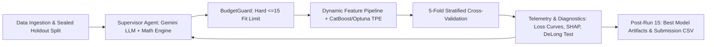

# System Architecture Overview

This project implements the **Autonomous AI Data Scientist (AADS)** for Utkrishta 2026 AI/ML Hackathon (Challenge 1: Budget-Constrained Experiment Optimization for Churn Prediction).

For the exhaustive, implementation-grade technical specification, see the root [TECHNICAL.md](../TECHNICAL.md).

## Core Architecture Highlights

### Key Pillars
1. **Budget Invariant**: Strictly enforces $\le 15$ model-training experiments using an atomic `BudgetGuard`.
2. **Dual-Brain Supervisor**: Combines Google Gemini LLM cognitive reasoning with a deterministic **Mathematical Inference Engine** (Overfitting Index, DeLong ROC-AUC significance test, SHAP vs Mutual Information rank correlation, ECE calibration).
3. **Optuna Guided TPE Bridge**: Reconciles Bayesian hyperparameter search with the 15-fit limit by using Optuna as a single-trial surrogate directed by the Supervisor's dynamic search spaces.
4. **CatBoost Core**: Exploits native categorical target encoding and symmetric tree regularization for tabular churn prediction.
5. **Sealed 20% Holdout Split**: Prevents test set leakage; holdout set is evaluated only after Experiment 15 concludes.

See [TECHNICAL.md](../TECHNICAL.md) for data schemas, mathematical derivations, module responsibilities, and agentic collaboration guidelines.
