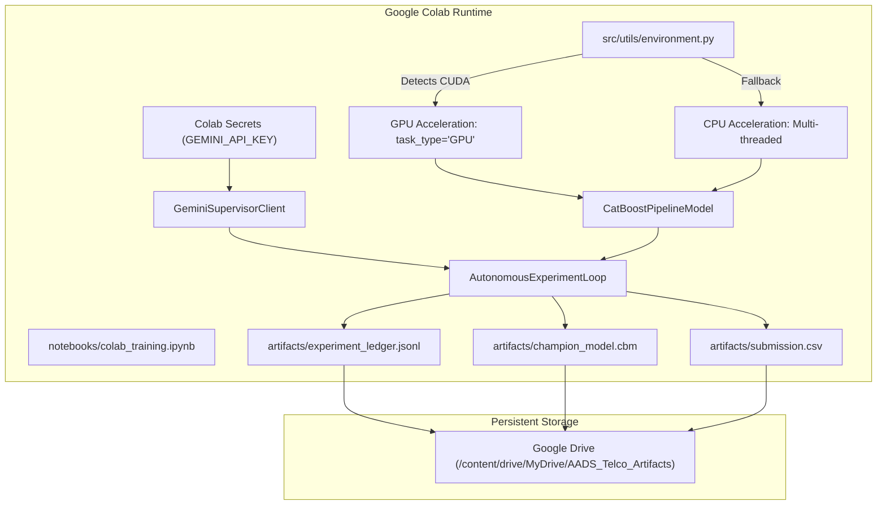

# System Architecture Overview

This project implements the **Autonomous AI Data Scientist (AADS)** for Utkrishta 2026 AI/ML Hackathon (Challenge 1: Budget-Constrained Experiment Optimization for Churn Prediction).

For the exhaustive, implementation-grade technical specification, see the root [TECHNICAL.md](../TECHNICAL.md).

## Core Architecture Highlights

```mermaid
flowchart LR
    A[Data Ingestion & Sealed Holdout Split] --> V[Data Provenance Guard: SHA-256 & Manifest]
    V --> P[Pre-Flight Meta-Feature Profiler: Zero-Cost Step 0]
    P --> L[Supervisor Locks Best Classifier: CatBoost for Runs 1-15]
    L --> B[Supervisor Agent: Gemini LLM + Math Engine]
    B --> C[BudgetGuard: Hard <=15 Fit Limit]
    C --> D[Dynamic Feature Pipeline + Locked Classifier / Optuna TPE]
    D --> E[5-Fold Stratified Cross-Validation]
    E --> F[Telemetry & Diagnostics: Loss Curves, SHAP, DeLong Test]
    F --> B
    F --> G[Post-Run 15: Best Model Artifacts & Submission CSV]
```

### Key Pillars
1. **Budget Invariant**: Strictly enforces $\le 15$ model-training experiments using an atomic `BudgetGuard`.
2. **Multi-Model Tournament Exploration & Winner Locking**: In tournament exploration mode, the orchestrator allocates initial runs (Runs 1 to $K$, testing `CatBoost`, `LightGBM`, `XGBoost`, `RandomForest`, and `LogisticRegression`) to empirically evaluate diverse inductive biases under identical 5-fold cross-validation splits and baseline feature representations. At Run $K$, the top-performing model family is crowned **Tournament Champion and LOCKED**. For all subsequent runs up to the 15-experiment hard cap, the Supervisor, Mathematical Engine, and Optuna TPE focus exclusively on fine-tuning hyperparameters, feature transformations, regularizations, and probability calibration for this winning architecture.
3. **Pre-Flight Classifier Selection & Lock (Zero Experiment Cost)**: Under competition rules (where data loading, cleaning, profiling, and feature design do NOT count as experiments), the Supervisor analyzes dataset meta-features (categorical ratio $80\%$, sample-to-dimension ratio, missingness, class imbalance) at Step 0. When tournament mode is disabled (`--no-tournament`), it selects the mathematically optimal classifier (`CatBoostClassifier`) and locks it for all 15 upcoming training experiments.
4. **Dataset Provenance & Cryptographic Validation Guard**: Generates immutable SHA-256 digests and row-level content hashes (`DatasetManifest`). Intercepts every training batch to mathematically verify index containment ($Index_{\text{in}} \equiv Index_{\text{canonical}}$) and cardinality ($|Rows| = N_{\text{canonical}}$). If unauthorized data or tampering is detected, it logs a critical security alert and **forces immediate restoration of the canonical dataset**.
5. **Dual-Brain Supervisor**: Combines Google Gemini LLM cognitive reasoning with a deterministic **Mathematical Inference Engine** (Overfitting Index, DeLong ROC-AUC significance test, SHAP vs Mutual Information rank correlation, ECE calibration).
6. **Air-Gapped Supervisor Isolation**: The LLM Supervisor has zero access to data ingestion paths and cannot pass raw rows or external data sources; it emits strictly validated configuration flags and hyperparameter schemas.
7. **Optuna Guided TPE Bridge**: Reconciles Bayesian hyperparameter search with the 15-fit limit by using Optuna as a single-trial surrogate directed by the Supervisor's dynamic search spaces for the locked classifier.
8. **Multi-Model Pipeline Suite & Hardware Acceleration**: Full concrete implementations of `CatBoostPipelineModel`, `LightGBMPipelineModel`, `XGBoostPipelineModel`, `RandomForestPipelineModel`, and `LogisticRegressionPipelineModel` implementing a unified `BaseModel` contract with automatic GPU/CPU device dispatch.
9. **Sealed 20% Holdout Split**: Prevents test set leakage; holdout set is evaluated only after Experiment 15 concludes.
10. **Google Colab Cloud Execution Layer**: Native support for execution inside Google Colab environments with one-click Jupyter notebooks, Colab Secrets integration, GPU acceleration, and Google Drive artifact persistence.

---

## Google Colab & Cloud Acceleration Architecture

### Cloud Execution Subsystems
- **Device Abstraction (`src/utils/environment.py`)**: Interrogates CUDA runtime and nvidia-smi. Resolves `--device auto` to GPU if an NVIDIA GPU (e.g. Tesla T4, A100) is present; otherwise falls back gracefully to CPU.
- **Resilient CatBoost Device Dispatcher**: Wraps CatBoost fold fits so that if GPU memory or CUDA driver errors occur, execution seamlessly falls back to CPU without breaking the 15-run experiment loop.
- **Air-Gapped Colab Secrets Integration**: Reads `userdata.get("GEMINI_API_KEY")` directly from Colab's native secure store. No `.env` files or hardcoded credentials required in cloud notebooks.
- **Automated Google Drive Syncing**: Optionally symlinks or mirrors the `artifacts/` folder to persistent Google Drive storage, ensuring all 15 experiment logs, the champion model weights, and the final submission CSV survive session termination.

See [GOOGLE_COLAB_TRAINING.md](GOOGLE_COLAB_TRAINING.md) for full setup instructions and [`notebooks/colab_training.ipynb`](../notebooks/colab_training.ipynb) for the turnkey notebook.

See [TECHNICAL.md](../TECHNICAL.md) for data schemas, mathematical derivations, module responsibilities, and agentic collaboration guidelines.
